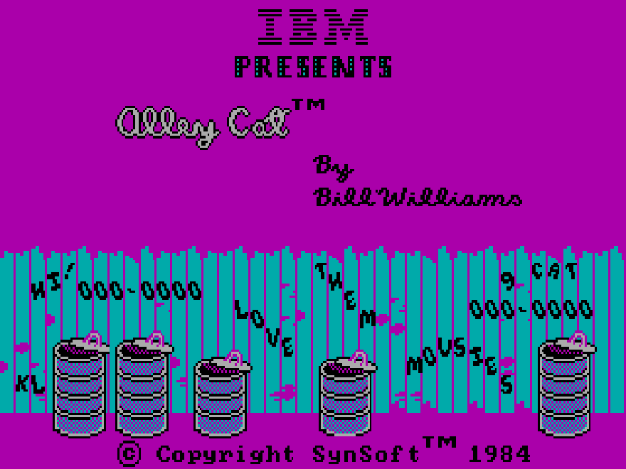
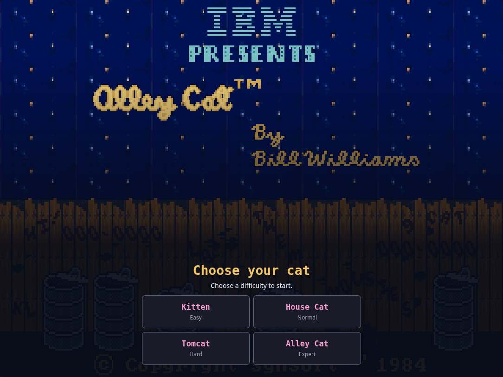
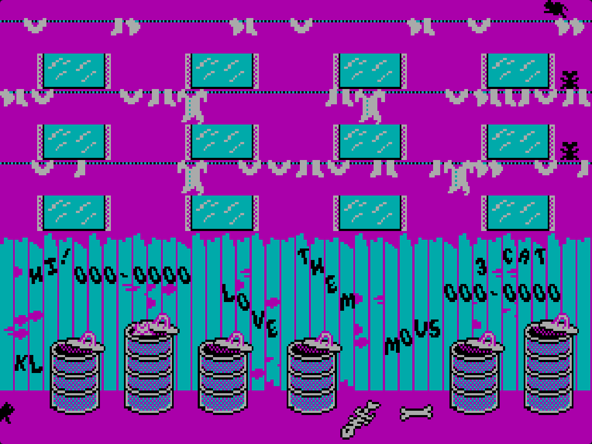
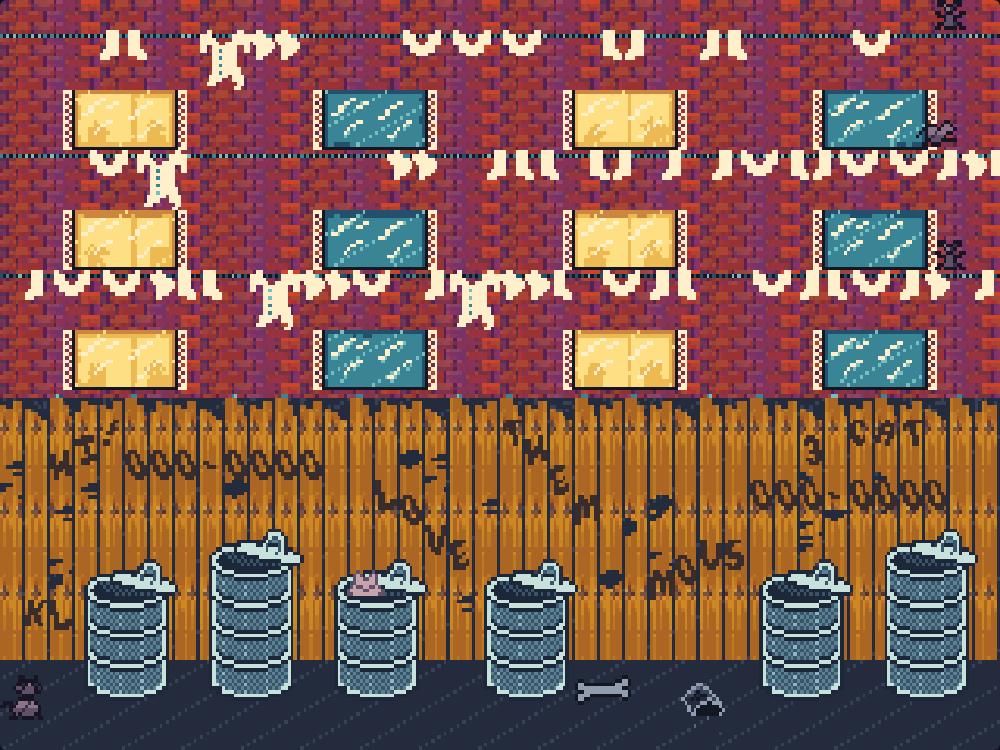
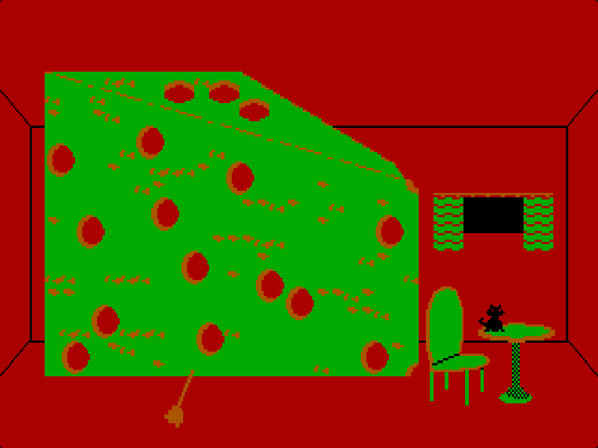
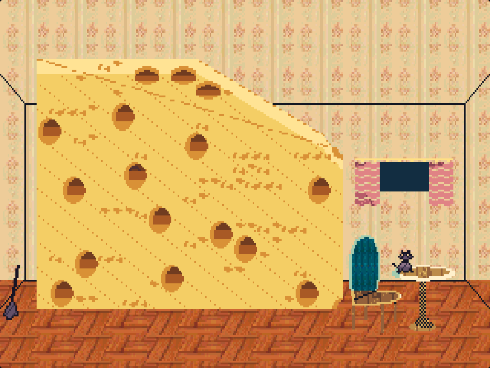

# Alley Cat — native JavaScript browser edition

[**Play online**](https://danzig666.github.io/alley-cat-browser/)
· [Standalone HTML](alley-cat.html)

The GitHub Pages site serves `index.html`, the same self-contained game as
`alley-cat.html`.

Open **alley-cat.html** in a modern browser, then click **Play Alley Cat**.
**The file preview inside chat does not run the game.** Download the file, or
extract it from `alley-cat-play.zip`, and open it in your browser. The Play
button is enabled only when the game's JavaScript has initialized; a static
preview displays download instructions instead.
The page contains all its JavaScript, graphics data, font, and sound routines.
It needs no installation, CDN, DOSBox, WebAssembly, or remote service. You can
also place this one file on any static website.

The game starts with **Color pixel art** and **AdLib-style FM**. The two
toggle buttons below the game work at any time, including fullscreen:

- **Graphics:** Color pixel art / Original CGA.
- **Audio:** AdLib-style FM / Original PC speaker. This changes **both music
  and sound effects**, and keeps the current sound/mute setting.

Switching either setting does not restart the game or change its position,
score, difficulty, timer, collision data, or input. The logical raster stays
320×200 and the displayed aspect stays 4:3.

Tap the original title to continue, tap a difficulty button, then tap the
game to start. Keyboard mode is selected automatically; the joystick question
is skipped. Desktop players can press **Enter**, choose **K**, **H**, **T**, or
**A**, then press **Enter** again.

| Control | Action |
| --- | --- |
| Arrow keys | Original movement and jumping |
| W / A / S / D | Up / left / down / right during play |
| Alt | Original special action |
| F | Special action during play |
| Space | Jump; hold left or right first to jump sideways |
| Q / E | Jump left / right with a single key |
| Z / C | Down-left / down-right, useful underwater |
| Home / Page Up | Original diagonal jump keys |
| Escape | Original “paws” mode; any key resumes |
| Ctrl-S | Original sound toggle |
| Ctrl-R | Original restart |
| Ctrl-M | Original menu |
| Ctrl-9 | Original nine-lives shortcut |
| Ctrl-Y | Original exit; Restart starts a new session |

On touch screens:

- Swipe horizontally and keep your finger down to move.
- Swipe up to jump, or diagonally up to jump sideways.
- Lift your finger to stop; quick flicks are held briefly so the game sees them.
- Tap for the special action, or hold a second finger on the game while steering.
- The arrow and Action buttons remain available as an alternative.

Click the screen to focus it when using a keyboard. The toolbar adds fullscreen
and browser audio mute. Fullscreen preserves the original 4:3 CRT display
shape in portrait and landscape; difficulty buttons remain accessible. A
viewport expansion fallback is used when the fullscreen API is unavailable.
Sound requires a user gesture. The game stops advancing when its tab is hidden.

Movement, jump and action input update immediately on press and release,
without waiting for the original two-tick (about 110 ms) keyboard poll. The
original jump physics and animation cadence remain. Use **Q/E** for an easy
diagonal jump, or hold a direction and then press **Space**. WASD/F aliases
apply during play; difficulty letters and Ctrl shortcuts keep their original
meaning. Independent physical keys can hold the same direction without one
key's release canceling another.

## Screenshots

Captured from the playable browser version. Each row shows the same frozen
game frame in both graphics modes; the displayed aspect ratio is 4:3.

| Scene | Original CGA | New pixel art |
| --- | --- | --- |
| Title |  |  |
| Alley |  |  |
| Cheese room |  |  |

## How this version was made

The upload is the IBM PC version of **Alley Cat**, by Bill Williams, 1984.
Its SHA-256 is:

```
4979c8867826e08881d1d4bec95c95d6bc1ac70fd21050ccdb4f733a50d7bfdd
```

The matching reverse-engineering reference is Gabriel Valky's
[CicoJit Alley Cat translation](https://github.com/gabonator/Projects/tree/master/CicoJit/gamelib/alleycat),
at commit `8cbd61a37fc0b6e7f9360d26c41fda07dc745f53`. The executable in the
[older InputCat reference](https://github.com/gabonator/Projects/tree/master/XenonResurrection/InputCat)
has exactly the same hash as the upload. Attribution to that work is retained
here; original game and reference-source rights remain with their owners.

`tools/build.py` converts the recovered C++ routines ahead of time into
JavaScript generator functions, preserving branches, unsigned arithmetic,
collision logic, score logic, minigames, AI, and original sound tables. The
browser executes these JavaScript functions directly. There is no runtime
instruction decoder or DOS emulator. The register and memory representations
are retained to avoid inventing replacement gameplay logic.

`src/engine.js` supplies new browser implementations of the hardware services:
CGA raster/palette, BIOS font drawing and clock, keyboard state, and the PIT
channel 2 / PC-speaker square wave through Web Audio. The uploaded binary is
embedded as the source of the game's original data, not executed as a DOS
program.

`src/color-art.js` adds generated material textures, per-object palettes,
pixel shading and colored animation frames. The recovered CGA pixels and
sprite transparency masks are hard stencils: outlines and occupied pixels
stay in their original positions. Generated images supply materials; they
are not substituted as whole room layouts. This avoids shifting furniture
or adding platforms when the image generator changes a composition. A
parallel color layer follows the native blitters' background saves and
restores, so moving sprites erase correctly in both styles. Original game
RAM is never changed by a graphics switch.

The cheese room captures the original finished wedge before characters are
drawn. A dedicated cheese material covers its full height and exact slope;
the original hole pixels receive recessed amber shading. Furniture shading
does not run over the cheese, and its hole positions and game geometry remain
unchanged.

The new audio voice is a Web Audio two-operator FM instrument with attack,
decay and release envelopes. It uses the game's original PIT note sequence,
pitch and gates for music and effects. It is **AdLib-inspired synthesis**,
not an OPL chip emulator or a newly composed soundtrack. Original PC speaker
selects the original square-wave path with the same recovered sound tables.

Generated masters are `art/alley.png` and `art/rooms.png`; compact native
rasters are embedded into the HTML. The generated previews are art direction
and material sheets. The playable version constrains them to the original
pixel geometry, including the romance room.

## Development

From this directory:

```sh
python3 tools/build.py
python3 -m http.server 8000
```

The build produces the identical standalone `index.html` and `alley-cat.html`, and the inspectable
`src/routines.js`. Python 3 is the only build requirement; serving is optional.
To regenerate the compact rasters after replacing either art master, run
`node tools/prepare-art.cjs` first. This optional asset step uses Chromium and
Playwright for the same nearest-neighbor rasterization as the game.

Browser checks use Node.js, Playwright, and Chromium:

```sh
node tests/smoke.cjs
node tests/rooms.cjs
node tests/mobile.cjs
node tests/presentation.cjs
node tests/controls.cjs
```

Playwright must be available to Node. `CHROMIUM_PATH` can select a browser
executable; the default is `/usr/bin/chromium`. Each test creates and closes
its own temporary HTTP server and browser. The room tests select each room at
the original main-loop dispatch; they do not remove game assertions or
substitute gameplay routines.

To refresh the README screenshots, run `ROOMS=4 node tests/rooms.cjs`, then
`node tools/capture-screenshots.cjs`.

## GitHub Pages

This is a static site: no server, package installation, or build service is
needed to play it. In **Settings → Pages**, select **Deploy from a branch**,
the **main** branch, and **/(root)**. The checked-in `index.html` is ready to
serve; `.nojekyll` disables Jekyll processing. Rebuild and commit both HTML
files after changing the game source.

With an authenticated GitHub CLI and the source committed on `main`,
`python3 tools/publish-github.py` creates a new public `alley-cat-browser`
repository in your account, pushes it, enables Pages, and sets its website
link. An optional argument chooses another repository name. Running it again
uses the same origin and updates that site's main branch.

## Validation and limits

Verified in Chromium:

- Original title: 15,120 static artwork pixels match an actual DOSBox run of
  the uploaded executable exactly, including CGA palette values.
- Title music produces a nonzero Web Audio waveform and original PIT divisor
  events; original sound on/off works.
- All four difficulty selections, alley movement and jumping, original pause
  overlay/resume, restart, menu, nine-lives shortcut, and graceful exit.
- All seven room modes initialize, render, update, and accept input without
  JavaScript errors.
- Responsive mobile layout; swipes move and jump, taps perform actions, and
  two-finger controls release independently. Touch-only menus skip the joystick
  question. Fullscreen keeps the display at 4:3 in portrait and landscape,
  including when menu controls are shown.
- The self-contained page runs with networking disabled and makes no external
  runtime or asset requests.
- Both live toggle buttons preserve game RAM, registers, current phase, frame,
  position, canvas dimensions, and mute. Switching CGA → color → CGA restores
  identical original pixels. Color art uses more than 64 colors in the alley.
- The original background blitters save and restore the added color pixels
  alongside the unchanged CGA raster. The new FM voice produces real audio,
  and the original music uses the PC-speaker waveform when selected.
- Color-mode skill selection retains every original text pixel with visible
  foreground/background contrast. Keyboard regression checks exercise actual
  Q/E, arrow and A/D + Space diagonal jumps, immediate input decoding/release,
  independent key holds, Ctrl-S, and release across pause and window blur.

A full winning playthrough and every collision/scoring path have **not** been
verified. Browser frame scheduling and the PC-speaker output may differ in
timing and timbre from an original PC. Hardware joystick mode is skipped in
favor of browser keyboard/touch input. Physical gamepad support and saved games
are not added. Other browsers have not been tested. This is a playable native
translation, not a claim of complete cycle-for-cycle equivalence.
